# GAMEDEV CIRCLE FES 2026 — 文化祭ゲーム展示サイト

ゲーム開発サークルの文化祭（2026年10月24日）で、展示した **21本のゲームの紹介** と **ハイスコアランキング** を行った Web サイトです。
来場者のスマホと会場のモニターで、当日実際に使われました。

**公開URL：https://gamedev-fes-2026.web.app/**

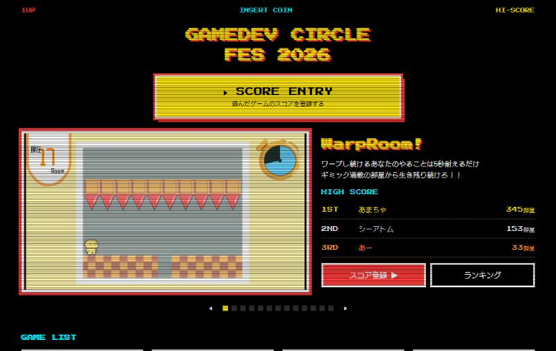

| 項目 | 内容 |
|---|---|
| 開発人数 | 1人 |
| 展示ゲーム | 21本（うちランキングあり 13本） |
| 主な技術 | HTML / CSS / JavaScript、Firebase（Hosting・Firestore・Authentication） |

---

## 目次

- [画面](#画面)
- [来場者の使い方](#来場者の使い方)
- [主な機能](#主な機能)
- [技術構成](#技術構成)
- [データの流れ](#データの流れ)
- [データ設計](#データ設計)
- [セキュリティ](#セキュリティ)
- [工夫したところ](#工夫したところ)
- [開発中に起きた問題と解決](#開発中に起きた問題と解決)
- [今後の展望](#今後の展望)
- [ディレクトリ構成](#ディレクトリ構成)
- [開発の進め方](#開発の進め方)
- [手元で動かす](#手元で動かす)

---

## 画面

デザインは、ゲームセンターのハイスコア画面をイメージした **アーケード風** にしました（黒い背景・ブラウン管風の横線・ドット風の文字）。

| トップページ（全体） | ランキング（スマホ） | スコア登録（スマホ） |
|:---:|:---:|:---:|
| 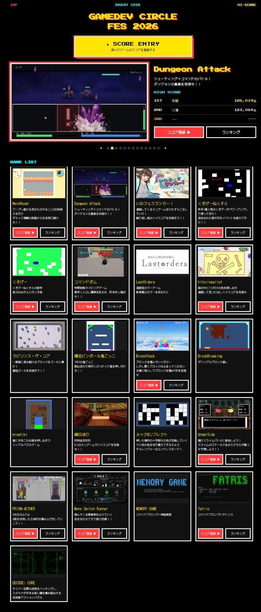 | 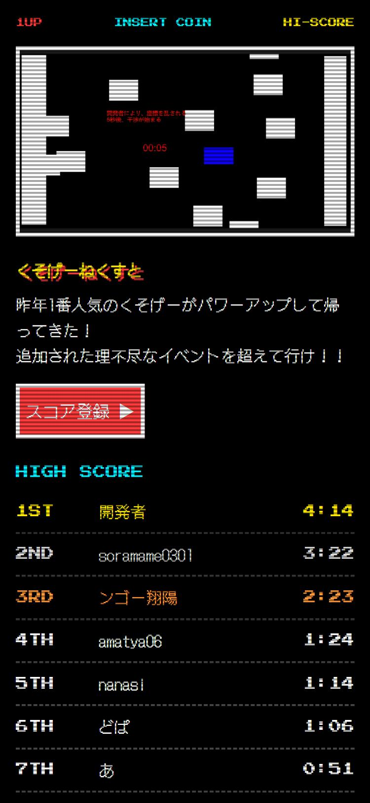 | 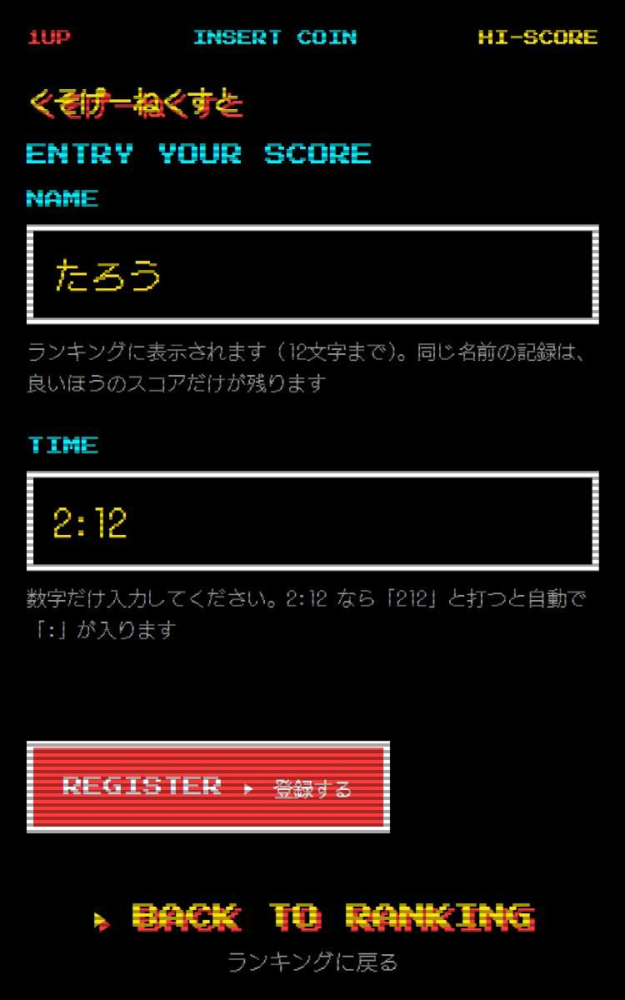 |
| 注目エリアとゲーム一覧 | ゲームごとの全順位 | 名前とスコアを入力 |

トップページは、大きく3つの部分でできています。

| ① SCORE ENTRY | ② 注目エリア | ③ ゲーム一覧 |
|:---:|:---:|:---:|
| 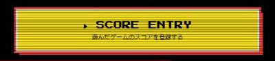 | 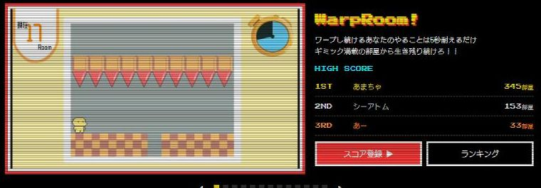 | 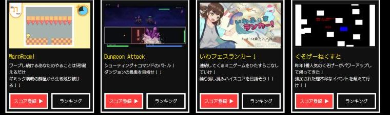 |
| スコア登録の入り口 | ランキングのある13本の紹介とTOP3を10秒ごとに自動で切り替え。会場のモニターにはこの部分だけを大きく表示 | 全21本の紹介。ランキングのあるゲームには「スコア登録」「ランキング」のボタン |

---

## 来場者の使い方

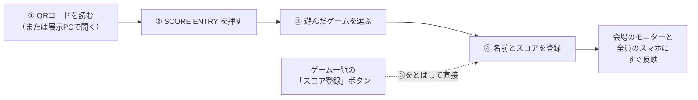

| ③ ゲームを選ぶ画面 | ④ 登録画面 |
|:---:|:---:|
| 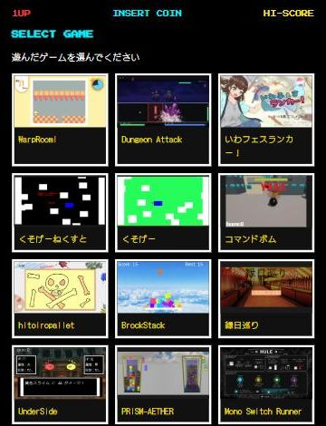 |  |

- QR コードは最初、ゲームごとに作る予定でしたが、印刷・設置の手間を考えて **トップページ用の1枚** にまとめました
- 同じ名前で何度登録しても、ランキングに残るのは **その人の最高スコアだけ**。同点は **先に記録した人** が上位です

---

## 主な機能

| 画面 | URL | 内容 |
|---|---|---|
| トップ | `/` | 注目エリア（紹介＋TOP3の自動切り替え）とゲーム一覧 |
| ランキング | `/ranking?game=<ID>` | ゲームごとの全順位。リアルタイムで更新 |
| スコア登録 | `/register` | 遊んだゲームを選び、名前とスコアを登録 |
| モニター表示 | `/display` | 会場のモニター用。注目エリアだけを画面いっぱいに表示 |
| 管理画面 | `/admin` | 管理者だけがログインでき、不適切な記録の修正・非表示ができる |

- **リアルタイム更新**：誰かが登録すると、会場のモニターや他の人のスマホのランキングが、再読み込みしなくても入れ替わる
- **点数とタイムの両方に対応**：「1,200点」「345部屋」「1,200 Coin」「2:12」など、ゲームごとに表示の形と単位を設定できる
- **スマホでのタイム入力**：数字だけを打つと自動で「:」が入る（`212` → `2:12`）。スマホの数字キーボードには「:」がないことが多いため
- **NG ワードのチェック**：表記をそろえてから照合する（「ﾊﾞ カ」「バーカ」も「ばか」として弾く）
- **受付の締め切り**：文化祭のあとは、画面とセキュリティルールの両方で登録を止め、当日の結果として公開を続けられる

---

## 技術構成

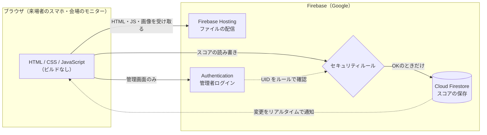

| 役割 | 使ったもの | 選んだ理由 |
|---|---|---|
| 画面 | HTML / CSS / JavaScript（ES モジュール） | 慣れている技術で確実に作り、自分で説明できるコードにしたかった |
| 公開 | Firebase Hosting | コマンド1つで公開でき、HTTPS と CDN が最初から付いている |
| データベース | Cloud Firestore | データの変更を自動で知らせる機能（`onSnapshot`）が標準で使える |
| ログイン | Firebase Authentication | ログインした人の UID が、そのままセキュリティルールで使える |
| 画像の変換・QR の作成 | Node.js（sharp / qrcode） | 画像を WebP に変換して軽くし、印刷用の QR コードを自動で作る |

**なぜ Firebase か**：公開するだけなら GitHub Pages や Vercel も同じくらい簡単ですが、データベースとログインは別のサービスを組み合わせる必要があります。Firebase は1つのサービスでそろい、ログインの情報をそのままデータベースのルールで使えるため、「管理者だけが修正できる」を確実に書けました。一方で、Firebase 独自の書き方になるので **別のサービスに乗り換えにくい** という弱点もあり、今回の規模を考えたうえで選んでいます。

---

## データの流れ

自分のサーバーは持たず、**ブラウザの JavaScript が直接 Firestore に読み書き** する構成です。

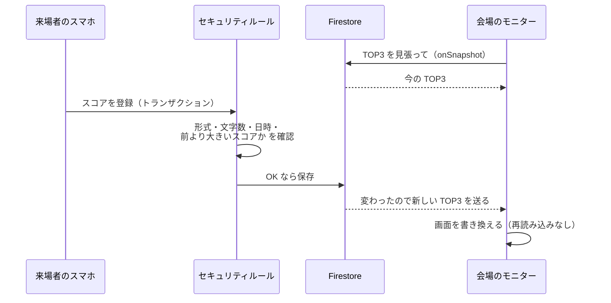

- **リアルタイム更新**：ランキングは `onSnapshot` で「変わったら教えて」と Firestore に頼んでおき、データが変わると Firestore から新しいデータが届く（[`public/js/scores.js`](public/js/scores.js)）
- **トランザクション**：登録は「今の記録を読む → 比べる → 良ければ書く」を1つの処理にして、ほぼ同時に登録されても記録が壊れないようにしている

---

## データ設計

### スコア（Firestore）

```
games / {ゲームID} / scores / {プレイヤー名}
                               ├ name:       "あまちゃ"
                               ├ score:      345          ← すべて整数（タイムは秒）
                               ├ achievedAt: 2026-10-24…  ← サーバーの時刻
                               └ hidden:     false        ← 管理者が非表示にしたか
```

- **プレイヤー名をそのまま記録の ID にした** ので、同じ名前の記録は自然に1件にまとまる。表示のたびに全記録を読んで集計する必要がなく、無料枠の読み込み回数も節約できる
- **スコアはすべて整数**。タイムは秒に直して保存し（2:12 → 132）、表示するときだけ形を変える。点数のゲームもタイムのゲームも、数字の大小だけで並べられる

### ゲーム情報（[`public/data/games.json`](public/data/games.json)）

ゲーム情報は HTML に直接書かず、データのファイルにまとめています。ページはこのデータを読んで自動で並べるので、ゲームの追加はデータを1件足すだけです。

```json
{
  "id": "warp-room",
  "name": "WarpRoom!",
  "image": "images/games/warp-room.webp",
  "description": "ワープし続けるあなたのやることは5秒耐えるだけ\nギミック満載の部屋から生き残り続けろ！！",
  "ranking": { "enabled": true, "order": "desc", "format": "points", "unit": "部屋" }
}
```

| 項目 | 意味 |
|---|---|
| `ranking.enabled` | ランキングがあるか |
| `ranking.order` | `desc`：大きいほど上位 / `asc`：小さいほど上位 |
| `ranking.format` | `points`：数字 / `time`：分:秒 |
| `ranking.unit` | 表示する単位（点・部屋・Coin など） |

「並び順」「表示形式」「単位」を分けたので、新しいパターンのゲームが来ても、組み合わせを変えるだけでプログラムを変えずに対応できます。

---

## セキュリティ

ブラウザから直接データベースにつながる構成なので、画面側のチェックは回避できてしまいます。そこで、**本当に守りたいことは Google 側で動く [Firestore のセキュリティルール](firestore.rules) に書き**、画面側のチェックは使いやすさのために使う、という **二重のチェック** にしています。

| 操作 | 誰ができるか・条件 |
|---|---|
| ランキングを見る | 誰でも。ただし非表示の記録は管理者だけ |
| 新しく登録 | 受付中で、項目が過不足なくそろい、名前が1〜12文字、スコアが整数、日時がサーバーの時刻のときだけ |
| 上書き | 受付中で、変えるのはスコアと日時だけ。**前より大きいスコアのときだけ** |
| 修正・非表示・削除 | 管理者の UID でログインしたときだけ |

ルールを書いたあと、**画面を通さず直接書き込む攻撃を6種類試し、すべて拒否される** ことを確認しました。

| 試した攻撃 | 防いでいるルール |
|---|---|
| 前より低いスコアで上書きする | 上書きは「新しいスコア ＞ 今のスコア」のときだけ |
| 他人の記録を非表示にする | 一般の人が変えられるのはスコアと日時だけ |
| 13文字以上の名前で登録する | 名前は1〜12文字だけ |
| 日時を偽装して同点で上位になる | 日時はサーバーの時刻だけ |
| 記録を削除する | 削除は管理者だけ |
| 非表示の記録まで読み込む | 一般の人は非表示でない記録の一覧だけ |

そのほか、名前を画面に出すときは HTML として解釈されないようにエスケープしています（他人の画面でスクリプトを動かされる XSS の対策）。

**今の弱点**：NG ワードのチェックは画面側だけなので、回避は可能です。文化祭では管理画面で非表示にする運用で補いました（[今後の展望](#今後の展望) を参照）。

---

## 工夫したところ

1. **「同じ人は最高スコアだけ」をデータの形とルールで実現** — 名前を記録の ID にし、ルールで「スコアが上がるときだけ上書き」と制限した
2. **データと見た目を分けて変更に強く** — 開発中にゲームが増えたときも、文化祭のあとにランキングを追加したときも、プログラムを変えずにデータの変更だけで対応できた
3. **画面とルールの二重のチェック** — 使いやすさは画面側、安全はルール側と役割を分けた
4. **会場の電波と無料枠への配慮** — 画像を横幅960px の WebP に変換して約6.7MB → 約350KB に軽量化。上部の切り替え表示は、表示中と次のゲームの画像だけを読み込む
5. **スマホでの入力のしやすさ** — タイムは数字だけで入力でき、自動で「分:秒」に整形される
6. **モニターとスマホで部品を共通化** — 注目エリアは同じ部品（[`carousel.js`](public/js/carousel.js)）を使い、`/display` では大きく表示するだけにした

---

## 開発中に起きた問題と解決

### 更新したら、一部の PC だけトップページが空になった

| | |
|---|---|
| **症状** | ゲームを追加して公開すると、ある PC だけトップページのほとんどが表示されなくなった。他の端末では正常だった |
| **原因** | ブラウザのキャッシュ。Firebase Hosting は初期設定でファイルを1時間ブラウザに保存させるため、その PC は **新しい HTML と古い JavaScript** を組み合わせて使っていた。新しい HTML が古い JavaScript にない機能を呼んでエラーになり、画面を組み立てる処理が止まっていた |
| **対策** | [`firebase.json`](firebase.json) で、HTML・JS・CSS・JSON は使う前に毎回新しいかを確認（`no-cache`）、通信量の多い画像は保存させる、とファイルの種類ごとに設定を分けた |
| **学び** | 更新したら、前に開いたことのある端末でも確認する。本番前に気づいて直せた |

### 公開直後にランキングが表示されなかった

「非表示を除く・スコア順・同点は日時順」で並べるために必要な **複合インデックス** が、Firebase 側で作成中だった（約2分半）。インデックスが必要な理由（複数の条件で並べ替えるため）も理解できた。

---

## 今後の展望

文化祭で実際に使ってみて、次のことに取り組みたいと考えています。

| | やりたいこと | 方法 |
|---|---|---|
| すぐ | ゲームごとの詳しい紹介ページ | `games.json` に項目を足し、ランキングと同じく1ページを使い回す |
| すぐ | プレイ映像を載せる | 動画は重いので、動画サービスに置いて埋め込む |
| すぐ | スコアが出ないゲームも盛り上げる | 会場で一番盛り上がったのはスコアが出ないゲームだった。難しいモードの挑戦人数とクリア人数を表示する |
| 長期 | ページからゲームを起動する | ブラウザは安全のため PC のプログラムを直接動かせないので、WebGL などブラウザで動く形に書き出して公開する |

あわせて、NG ワードのチェックをサーバー側（Cloud Functions）に移し、AI による判定も加えたいと考えています。

---

## ディレクトリ構成

```
public/                 公開するファイル（Firebase Hosting）
├ index.html            トップページ
├ ranking.html          ゲームごとのランキング
├ register.html         スコア登録（ゲームを選ぶ画面を含む）
├ display.html          会場のモニター用
├ admin.html            管理画面
├ css/style.css         デザイン（アーケード風）
├ data/games.json       ゲーム情報
├ images/games/         ゲームの画像（WebP）
└ js/
   ├ firebase.js        Firebase への接続
   ├ games.js           ゲーム情報の読み込みと、スコアの表示形式の変換
   ├ scores.js          スコアの読み書き（Firestore とのやりとりはここに集約）
   ├ carousel.js        注目エリア（トップとモニターで共通）
   ├ name-check.js      名前と NG ワードのチェック
   └ config.js          受付中かどうかの設定
firestore.rules         セキュリティルール
firestore.indexes.json  ランキングの並べ替え用の索引
firebase.json           公開の設定（キャッシュの設定など）
scripts/                画像の変換・QR コードの作成・確認用サーバー
docs/                   要件定義書、デザインの見本、発表資料
```

---

## 開発の進め方

- 「**文化祭当日に確実に動く版**」と「**あとで改善する版**」の2段階に分けて進めた
- 設計で迷ったところは、比べた選択肢と選んだ理由を [要件定義書](docs/requirements.md) に記録した（スコアの登録方式、不正対策の範囲、データの形、デザイン、QR コードの枚数など）
- 生成 AI（Claude Code）を使いながら開発した。要件や設計の判断は、選択肢を比べて自分で決め、生成されたコードは説明できるところまで理解するようにした

---

## 手元で動かす

```bash
npm install
node scripts/dev-server.mjs    # http://localhost:5173 で確認
npm run images                 # 素材/画像 の PNG を WebP に変換
npm run qr                     # 印刷用の QR コードページを作成
npx firebase deploy            # 公開（Firebase へのログインが必要）
```
